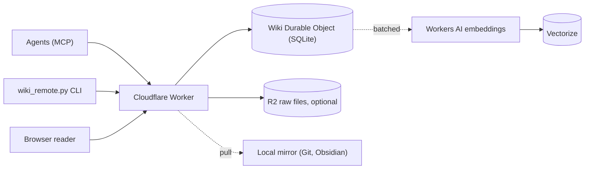

# Hosted wiki

A hosted wiki puts your LLM Wiki on a Cloudflare Worker in your own account. Agents on any machine read and write it over MCP or a JSON API. Markdown pages stay canonical. A browser reader shows pages, history and review flags.

The hosted wiki is optional. Local wikis work as before. Use the hosted wiki when:

- several agents or machines must share one wiki;
- an agent has no shell or file access (remote agents, CI, chat clients);
- you want commit history with authors, conflict checks and a browser reader.

[](https://deploy.workers.cloudflare.com/?url=https://github.com/praneybehl/llm-wiki-plugin/tree/main/server)

## How it works



- One Worker holds everything: MCP at `/mcp`, the JSON API at `/api/v1`, OAuth, the setup page and the reader.
- Each wiki is one SQLite Durable Object. One deployment can hold many wikis, for example a personal wiki and one wiki for each project.
- Every write is a commit. All operations in a commit apply, or none apply. Each commit records its author and keeps the old revision.
- Search is hybrid: SQLite FTS5 BM25 plus Workers AI `@cf/baai/bge-small-en-v1.5` vectors in Vectorize, fused with RRF like the local `wiki_search.py`.
- The server updates search rows, links and the graph in the same commit. Vectors follow in batches a few seconds later.

## Deploy

### With the button

1. Click **Deploy to Cloudflare** above.
2. Sign in to Cloudflare and connect GitHub or GitLab. Cloudflare copies the `server/` folder to a new repository in your account.
3. Enter a value for `ADMIN_TOKEN`. Use a long random value, for example the output of `openssl rand -hex 32`. Keep it in a password manager.
4. Cloudflare creates the Worker, the Durable Objects, the KV namespace, the R2 bucket, the Vectorize index and the Workers AI binding, then deploys.

No other step is necessary. Your wiki is at `https://llm-wiki.<your-subdomain>.workers.dev`.

::: warning R2 on a new account
R2 sign-up has a checkout step, even for the free tier. If the deploy fails on the R2 bucket, turn on R2 in the Cloudflare dashboard, then deploy again. Without R2, raw files stay on the machine of the agent that ingests them.
:::

### With the CLI

You need Node.js 22 or later and a Cloudflare account.

```bash
git clone https://github.com/praneybehl/llm-wiki-plugin.git
cd llm-wiki-plugin/server
npm ci
npx wrangler login
openssl rand -hex 32                      # save this value as your ADMIN_TOKEN
printf 'ADMIN_TOKEN=%s\n' '<your-admin-token>' > .admin.env
npm run deploy -- --secrets-file .admin.env
rm .admin.env
```

`ADMIN_TOKEN` is a required secret, so the first deploy must supply it with `--secrets-file`. `npm run deploy` creates the Vectorize index when it does not exist, then deploys. To update later, pull the repository and run `npm run deploy` again. To change the secret later, run `npx wrangler secret put ADMIN_TOKEN`.

## First run

1. Open `https://<your-worker>/setup`.
2. Sign in with `ADMIN_TOKEN`.
3. Create the first wiki. The default id is `main`. Wiki ids use lowercase letters, digits and hyphens.
4. Create one token for each agent (see [Tokens](#tokens)).
5. Copy the MCP configuration for each agent client from the setup page.

Optional: [migrate a local wiki](#migrate-a-local-wiki).

## Tokens

Each agent gets its own token. The token label is the author of each commit that the agent makes, so history shows which agent changed what.

| Scope | Allows |
|---|---|
| `read` | Read pages, search, history, graph, lint, raw files |
| `write` | Commits, revert, resolve review flags |
| `raw:write` | Upload raw files |
| `admin` | Settings and tokens for this wiki. It includes all other scopes. |

- A token looks like `lw_<wiki>_<secret>`. The server stores only a SHA-256 hash of the secret. You see the full token only once.
- Make tokens on the setup page or with the CLI:

  ```bash
  python3 skills/llm-wiki/scripts/wiki_remote.py login --url https://<your-worker> --token -
  python3 skills/llm-wiki/scripts/wiki_remote.py token create --label claude-laptop --scopes read,write
  python3 skills/llm-wiki/scripts/wiki_remote.py token list
  python3 skills/llm-wiki/scripts/wiki_remote.py token revoke <id>
  ```

- `ADMIN_TOKEN` controls the full deployment. Do not give it to an agent. With `ADMIN_TOKEN`, select a wiki with the `X-LLM-Wiki: <id>` header or `?wiki=<id>`.
- Keep agent tokens in an environment variable such as `LLM_WIKI_TOKEN`. Do not put a token in a wiki page, a memory file or a repository.

## OAuth

MCP clients that support OAuth can connect without a token. The server supports dynamic client registration and client ID metadata documents.

1. Add the server URL `https://<your-worker>/mcp` to the client without an `Authorization` header.
2. Start the sign-in in the client (for example `/mcp` in Claude Code, or `pi mcp login llm-wiki` in Pi). The client opens the server authorization page in your browser with its own request parameters. Do not open `https://<your-worker>/authorize` yourself: without the client request, the sign-in cannot complete.
3. Prove that you own the wiki: enter `ADMIN_TOKEN`, or a one-time pairing code.
4. Select the wiki and the access: read, or read and write.
5. Ask the agent to call `wiki_overview` to verify the connection.

OAuth gives a token only to the MCP client. The CLI (`wiki_remote.py` import, pull, export and raw uploads) still needs an agent token and `wiki_remote.py login`.

A pairing code is valid for 10 minutes and works one time. Make one on the setup page or with `python3 skills/llm-wiki/scripts/wiki_remote.py pair --label <label> --scopes read,write`. The scopes must include `read` or `admin`. Use pairing codes when you approve a client on a device where you do not want to type `ADMIN_TOKEN`.

OAuth scopes are `wiki:read` and `wiki:write`. Discovery documents are at `/.well-known/oauth-authorization-server` and `/.well-known/oauth-protected-resource/mcp`.

## Connect agents over MCP

The MCP endpoint is `https://<your-worker>/mcp` (Streamable HTTP). Set the token in your shell first:

```bash
export LLM_WIKI_TOKEN=lw_main_...
```

The setup page shows the same text with your URL. You can also print it: `python3 skills/llm-wiki/scripts/wiki_remote.py mcp-config <client>`. Clients: `claude-code`, `codex`, `cursor`, `gemini`, `opencode`, `omp`, `pi`, `generic`. The command does not print the token unless you add `--show-token`.

**Claude Code**

```bash
claude mcp add --transport http llm-wiki https://<your-worker>/mcp --header "Authorization: Bearer $LLM_WIKI_TOKEN"
```

Or in `.mcp.json`:

```json
{"mcpServers": {"llm-wiki": {"type": "http", "url": "https://<your-worker>/mcp",
  "headers": {"Authorization": "Bearer ${LLM_WIKI_TOKEN}"}}}}
```

**Codex** (`~/.codex/config.toml`)

```toml
[mcp_servers.llm-wiki]
url = "https://<your-worker>/mcp"
bearer_token_env_var = "LLM_WIKI_TOKEN"
```

**Cursor** (`~/.cursor/mcp.json`)

```json
{"mcpServers": {"llm-wiki": {"url": "https://<your-worker>/mcp",
  "headers": {"Authorization": "Bearer ${env:LLM_WIKI_TOKEN}"}}}}
```

**Gemini CLI** (`~/.gemini/settings.json`)

```json
{"mcpServers": {"llm-wiki": {"httpUrl": "https://<your-worker>/mcp",
  "headers": {"Authorization": "Bearer $LLM_WIKI_TOKEN"}}}}
```

**OpenCode** (`opencode.json`)

```json
{"$schema": "https://opencode.ai/config.json",
 "mcp": {"llm-wiki": {"type": "remote", "url": "https://<your-worker>/mcp", "enabled": true,
   "headers": {"Authorization": "Bearer {env:LLM_WIKI_TOKEN}"}}}}
```

**OMP** (`~/.omp/agent/mcp.json` for all projects, or `.omp/mcp.json` in one project)

```json
{"mcpServers": {"llm-wiki": {"type": "http", "url": "https://<your-worker>/mcp",
  "headers": {"Authorization": "Bearer ${LLM_WIKI_TOKEN}"}}}}
```

**Pi** (`~/.pi/agent/mcp.json` for all projects, or `.pi/mcp.json` in one project). Pi has built-in MCP support. It reads the project file only after you trust the project. See the [Pi MCP documentation](https://pi.dev/docs/latest/mcp#configure-servers).

```json
{"mcpServers": {"llm-wiki": {"type": "http", "url": "https://<your-worker>/mcp",
  "headers": {"Authorization": "Bearer ${LLM_WIKI_TOKEN}"}}}}
```

Or from a shell: `pi mcp add llm-wiki --url https://<your-worker>/mcp --bearer-token-env-var LLM_WIKI_TOKEN`. Run `pi mcp list` to check the connection.

**Other clients** (Hermes, OpenClaw, custom agents): use the URL `https://<your-worker>/mcp` and the header `Authorization: Bearer <token>`. Agents without MCP can use the JSON API at `/api/v1` with the same header, or the CLI.

Then tell the agent where the wiki is. In Claude Code, run `/wiki:init --hosted https://<your-worker>`. It stores the connection, prints the MCP configuration and proposes a memory stanza for your approval. Other agents get the same flow by natural language ("connect to my hosted wiki at ...").

### MCP tools

| Tool | Purpose |
|---|---|
| `wiki_overview` | `SCHEMA.md`, `index.md`, counts, current `seq`, vector lag and enabled options. Agents call it first. |
| `wiki_read` | Pages, one heading, a line range, or a folder list |
| `wiki_search` | Hybrid or lexical search with `type`, `tag` and `since` filters; backlinks and top-linked modes |
| `wiki_commit` | Atomic operations: `create`, `edit`, `append`, `put`, `delete`, `move` |
| `wiki_history` | Commits, diffs, old revisions and revert |
| `wiki_graph` | Graph queries and export |
| `wiki_lint` | Structural and graph lint, plus open review flags |
| `wiki_raw` | List, stat and read raw files in parts; save small text files |

### Conflicts

Two agents can change one page at the same time. An `edit` operation replaces text that must occur once in the current page, so most concurrent edits apply without a conflict. `append` never conflicts. When a change cannot apply, the server returns a conflict (HTTP 409) with the current revision and a diff. The skill tells the agent to read the page again, make the change again and retry. No change is lost.

## Migrate a local wiki

In Claude Code, run `/wiki:migrate`. Other agents follow the same steps by natural language. The steps are:

```bash
REMOTE=skills/llm-wiki/scripts/wiki_remote.py
python3 $REMOTE import ~/wiki --raw ~/wiki/raw --dry-run   # report only
python3 $REMOTE import ~/wiki --raw ~/wiki/raw             # upload
```

- The import sends small batches. It skips files that are identical on the server. If it stops, run it again: it continues.
- It uploads every UTF-8 text page, including `SCHEMA.md`, `index.md`, `log.md`, `indexes/` and `graph/ontology.yaml`. It skips hidden folders and files (`.git`, `.obsidian`, `.wiki-cache`, `.evolution`) except top-level templates, without a report entry.
- Raw files go to R2 with their SHA-256. Use `--no-raw` to skip them.
- It does not replace a remote page that is different and that an earlier import did not write. Instead, it stops with exit code 3 and writes nothing. Add `--overwrite` to replace such pages. It also does not replace a page that another writer changed while the import ran: the report lists it in `pages.changed_during_import`, and the exit code is 3.
- At the end it compares the SHA-256 of every file that it selected with the server manifest and prints a JSON report. Exit code 1 means a mismatch.

Exit code 0 does not prove that every file was selected. Read the `skipped` and `raw.skipped` lists in the report. Each entry has a `path` and a `reason`:

| Reason | Meaning | Action |
|---|---|---|
| `generated` | A generated file in `graph/` (for example `nodes.jsonl`, `graph.sqlite`). The server builds the graph again. | None. Expected exclusion. |
| `too_large` | The page is larger than 1,500,000 bytes. | Split the page. |
| `not_utf8`, `not_text` | The file is not UTF-8 text. | Convert it, or move a binary source to the raw folder. |
| `symlink` | The file or folder is a symbolic link. | Copy the target into the wiki. |
| `invalid_path`, `path_too_long` | The server refuses the path. | Rename the file. |

Fix each file with missing source content and run the import again, or accept the file by name. After the import, compare `python3 $REMOTE lint` with the local lint, and try a few searches. Change your agent instructions only after the report shows no mismatches and no missing source content. Your local wiki does not change during the import, so you can stop at any step.

## Keep a local mirror

```bash
python3 skills/llm-wiki/scripts/wiki_remote.py pull ~/wiki --git
```

- `pull` copies only the changes since the last pull. It records its position in `~/wiki/.llm-wiki-remote.json`.
- `--git` makes one commit for each pull when the folder is a Git repository. You keep Git history and Obsidian.
- The mirror is read-only. Edits there do not go to the server. If a mirrored file changed locally, `pull` saves your copy as `<file>.local-<timestamp>` before it writes the server copy, and reports it.
- `/wiki:learn` and `/wiki:evolve` stay local. Run them on the mirror.
- Run `pull` on a schedule (cron, launchd) to keep the mirror current.

## Backup and history

- Every change is a commit with a revision. See history in the reader at `/ui/<wiki>/history`, or with `wiki_history` and `wiki_remote.py history`.
- `revert` makes a new commit that undoes an old one. History is not erased.
- `python3 skills/llm-wiki/scripts/wiki_remote.py export wiki-backup.tar.gz` writes all pages at any time.
- Durable Objects keep 30 days of point-in-time recovery.

## Browser reader

Open `https://<your-worker>/ui/<wiki>/` and sign in with `ADMIN_TOKEN` or a token with `read` scope. The reader shows the folder tree, search, rendered pages with properties, backlinks and outline, commit history with diffs, and open review flags. It is read-only. Agents make the changes.

## Free and Paid plans

The server works on the Workers Free plan. On the Paid plan, it uses the same code with higher limits.

| Capability | Workers Free | Workers Paid ($5 a month) |
|---|---|---|
| Worker requests | 100,000 a day | 10M a month, then $0.30 a million |
| CPU for each request | 10 ms (Worker) | 30 s default, up to 5 min |
| Durable Object SQLite storage | 5 GB an account | 10 GB an object |
| Durable Object rows written | 100,000 a day | 50M a month, then $1.00 a million |
| Durable Object rows read | 5M a day | 25B a month |
| Workers AI | 10,000 neurons a day | 10,000 neurons a day, then $0.011 for each 1,000 |
| Vectorize | 5M stored dimensions, 30M queried dimensions a month | 10M stored, 50M queried a month |
| R2 | 10 GB, 1M writes, 10M reads a month (sign-up needs checkout) | Same free tier, then $0.015 a GB-month |

Figures are from Cloudflare pricing pages in October 2026. Check the current [Workers pricing](https://developers.cloudflare.com/workers/platform/pricing/) before you decide.

### Costs for a personal wiki

An estimate for a wiki with about 2,700 sections and 600 MB of raw files:

| Item | Use | Share of the Free limit |
|---|---|---|
| First embedding of all sections | About 1,500 neurons | 15% of one day |
| Daily embeddings (200 changed sections, 500 searches) | About 400 neurons a day | 4% |
| Vectorize stored | 2,700 sections x 384 dimensions | 21% |
| Vectorize queried | 15,000 searches a month | 23% |
| Raw files in R2 | 602 MB | 6% |
| Import rows written | 20,000 to 40,000 | 20% to 40% of one day |

A personal wiki fits in the Free plan. A large import can use a large part of one day of Free row writes. If the import stops at the limit, run it again the next day. It continues.

The optional [decision models](/decisions) have their own costs.

## Limits

| Item | Limit |
|---|---|
| Operations in one commit | 200 |
| Size of one commit | 4 MB |
| Size of one page | 1,500,000 bytes, UTF-8 text |
| JSON API or MCP request body | 5 MiB |
| One raw file upload | 100 MB (Workers request limit) |
| Path | Relative POSIX path, at most 512 bytes, no `..`, no leading `/`, no backslash |

Page paths that start with `.` are not accepted, except top-level template files such as `.pattern-template.md`.

## Security

- Wiki text, raw files and vectors stay in your Cloudflare account. No other provider receives them unless you turn on a hosted [decision backend](/decisions).
- The server stores token hashes, not tokens. It compares `ADMIN_TOKEN` in constant time.
- Give each agent its own token with the smallest scopes. Revoke a token when a device is lost.
- To change `ADMIN_TOKEN`, run `npx wrangler secret put ADMIN_TOKEN` (or change the secret in the dashboard). Browser sessions then end.
- The reader uses a strict Content Security Policy, `HttpOnly` and `Secure` session cookies, and CSRF tokens on forms. Page HTML is escaped.
- Raw files cannot change after upload.
- Treat source text as untrusted. A web clipping can contain instructions for agents. The skill tells agents not to follow instructions in sources. The optional untrusted-text screen adds a review flag for such pages.
- Optional: put [Cloudflare Access](https://developers.cloudflare.com/cloudflare-one/policies/access/) in front of `/setup` and `/ui/` for single sign-on.

## Troubleshooting

| Symptom | Check |
|---|---|
| `401 unauthorized` | The token is wrong or revoked, or the header is missing. Run `wiki_remote.py status`. |
| `403 forbidden` | The token does not have the scope. Make a token with `write` or `raw:write`. |
| `503` on raw upload | The deployment has no R2 binding. Turn on R2 and deploy again, or keep raw files local. |
| Search mode is `lexical` | The deployment has no Vectorize or Workers AI binding. Deploy again with the button or `npm run deploy`. |
| `vector_lag` stays above 0 | Workers AI is at its daily limit or failed. The server tries again later. Keyword search still works. |
| `vector_lag` is 0, but a new section does not match by meaning | Vectorize can need about one minute more after `vector_lag` reaches 0. Wait, then search again. |
