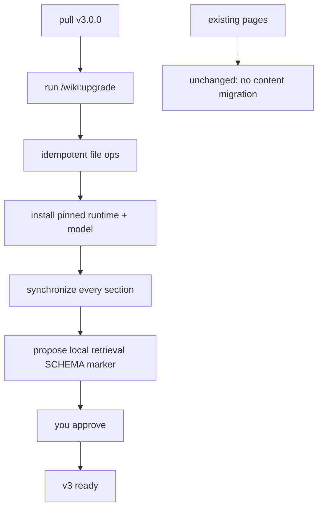

<!-- Adapted from: commands/wiki/upgrade.md and the v4 hosted wiki plan. -->

# Upgrade to v4.0.0

v4.0.0 adds an optional hosted backend and an optional decision layer. Local wikis, page formats, local search and all commands work as before. The major version is for the removal of the Paperclip companion.

## What changes for you

- **Local wikis need no migration.** Nothing under `wiki/` changes. Local search, lint, graph and evolution scripts are the same.
- **Hosted wiki (optional).** Deploy one Cloudflare Worker with the Deploy button. Agents connect over MCP or a JSON API with their own tokens or OAuth. See [Hosted wiki](/hosted).
- **New commands.** `/wiki:init --hosted <url>` connects an agent to a hosted wiki. `/wiki:migrate` moves a local wiki to a hosted wiki, verifies every file that it selects, and reports the files that it skipped.
- **New CLI.** `skills/llm-wiki/scripts/wiki_remote.py` (Python standard library only) handles login, tokens, import, pull mirror, export, raw files and MCP configuration.
- **Decision models (optional, off by default).** Small models can gate search relevance, check graph evidence and screen untrusted text. See [Decision models](/decisions).
- **Paperclip companion removed.** The `integrations/paperclip/` plugin and its docs are gone. The npm package was never published to the registry, so no registry action is necessary. If you need Paperclip, stay on v3.2.x. The [v3.2.0 documentation](/v3/) stays available.

## The upgrade

1. **Update the plugin or skill** the same way you installed it. For Claude Code, run the marketplace install again. For skill-only agents, run `npx skills add` again.
2. **Run `/wiki:upgrade`** against your wiki. It runs the same idempotent file operations and runtime check as v3.2. No new `SCHEMA.md` section is required.
3. **Optional: move to a hosted wiki.** Deploy the server, then run `/wiki:migrate`. Your local wiki does not change until the import passes its verification.

::: info Pull mirrors
If a folder is a `pull` mirror of a hosted wiki (it contains `.llm-wiki-remote.json`), do not edit it or run upgrade writes on it. Change the hosted wiki, then pull again.
:::

## Upgrading from before v3.2

v3.2.0 adds optional experience capture and evaluated skill improvements. Existing wikis, frontmatter and CLI flags remain compatible. It does not enable a background optimizer.

Run `/wiki:upgrade` against your configured wiki. The existing runtime setup remains mandatory. Upgrade adds `.experience-template.json`, `.pattern-template.md` and `.evolution/README.md` only if absent; custom files and SCHEMA.md are preserved. It proposes an optional `## Skill evolution` schema section for review.

Use `/wiki:learn` for verified task experience, then `/wiki:evolve` for evidence-linked proposals and measured promotion. No evaluation or skill replacement occurs during upgrade. Back up `.evolution/` as durable history, unlike the disposable `.wiki-cache/`. See [Learning and skill evolution](/evolution) for the runner contract, pilot suite, inference budgets and rollback.

## Upgrading from before v3.0


v3.0.0 replaces provider-backed embeddings with default local FastEmbed + sqlite-vec retrieval. Existing Markdown stays untouched; only the disposable vector index changes.

::: info No content migration
No page or frontmatter format changed. The old `embeddings.jsonl` cache is ignored and can be deleted; `/wiki:upgrade` builds `embeddings.sqlite` locally and synchronizes every current section.
:::



## Why it's a major version

The default section search now initializes a local model and sqlite-vec index instead of staying lexical unless a provider is configured. The data boundary becomes strictly local and the old provider environment variables and approval flag are removed. Direct `python wiki_search.py "<query>" --no-embed` preserves dependency-free BM25.

## The upgrade

1. **Pull the current release.** Update the plugin the same way you installed it: for Claude Code, re-run the marketplace install; for skill-only agents, re-run `npx skills add`.
2. **Run the upgrade.** In Claude Code:

   ```bash
   /wiki:upgrade
   ```

   Or directly, pass the installed script and the selected base directory separately. For a project wiki:

   ```bash
   python "${CLAUDE_PLUGIN_ROOT}/skills/llm-wiki/scripts/init_wiki.py" "<absolute-project-root>" --upgrade
   ```

   For the standard personal global layout:

   ```bash
   python "${CLAUDE_PLUGIN_ROOT}/skills/llm-wiki/scripts/init_wiki.py" "<absolute-home-directory>" --wiki-dir wiki --raw-dir wiki/raw --upgrade
   ```

   For a skill-only install, replace `${CLAUDE_PLUGIN_ROOT}/skills/llm-wiki` with that agent's installed `llm-wiki` skill directory. Never use the plugin or skill directory as the base directory.

   > **Expected**: Idempotent file operations leave existing pages untouched. Runtime setup then reports `"status": "ready"` with pinned dependency versions, model, page count, section count, and vector-index path before the command reports the missing SCHEMA marker.
3. **Approve the SCHEMA.md merge.** Add the local semantic backend lines from the current template to your existing `## Retrieval` section. SCHEMA.md is co-evolved with you and is never modified silently.

Re-running the upgrade is idempotent: existing content stays unchanged, dependencies/model are verified, and only changed or missing vectors are embedded.

## What changes for you

- **Existing pages need no changes.** Nothing canonical under `wiki/` is rewritten.
- **Section search is local hybrid by default.** FastEmbed + sqlite-vec semantic ranking is fused with BM25. Run the script directly with Python and `--no-embed` for dependency-free lexical retrieval, or use `--granularity page` for whole-page ranking.
- **Upgrade installs everything.** The command resolves pinned FastEmbed, sqlite-vec, and PyYAML packages through `uv`, downloads the pinned model if absent, builds the parse cache, and embeds all current sections.
- **`wiki/.wiki-cache/` is regenerable.** `search-index.json` and `embeddings.sqlite` are gitignored and safe to delete. Legacy `embeddings.jsonl` is ignored.
- **No provider setup remains.** No API key, endpoint, data-transfer approval, or per-query charge is involved.

::: warning
No wiki yet? There's nothing to upgrade: run [`/wiki:init`](/getting-started) instead.
:::
