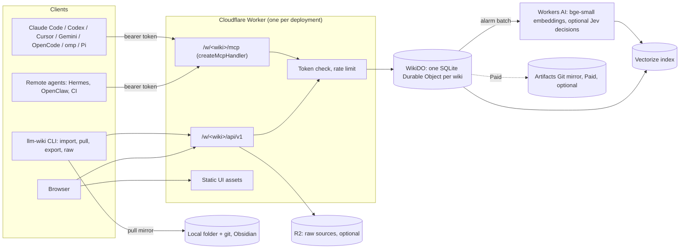

# LLM Wiki v4 plan: hosted wiki on Cloudflare, Paperclip removal, optional decision models

Status: direction approved on 2026-10-29. Cloudflare first, with single-click deployment as the main requirement. Phase 0 has not started. No code is written.
Date: 2026-10-29. Prepared for Praney by the omp agent.
Facts were checked on 2026-10-29. Each section lists its sources. `[INFERENCE]` marks a conclusion that no source states.

## 1. Summary

- Single-click deployment is the main requirement. A "Deploy to Cloudflare" button creates every resource. The user then enters one admin secret.
- Keep Markdown as the canonical data. Put one wiki in one SQLite Durable Object (DO). The DO does all writes in sequence, so no update is lost.
- Agents connect through one Worker. The Worker serves MCP (Streamable HTTP), a JSON API and a read-only web UI.
- Each agent gets its own bearer token. All five main MCP clients can send a static `Authorization` header. OAuth in the same Worker serves claude.ai and ChatGPT connectors.
- Search stays hybrid. SQLite FTS5 gives the keyword leg. Workers AI `bge-small-en-v1.5` and Vectorize give the vector leg. RRF joins them.
- The design works on the Workers Free plan. Workers Paid ($5) adds CPU headroom, a Git mirror (Artifacts) and more storage.
- Local mode (files on disk, Python scripts) stays. Hosted mode is a second backend, not a replacement.
- v4.0.0 removes the Paperclip integration. Its TypeScript search, lint, stats and reader code moves into the new server.
- Decision models ship in v4.0. They are optional and off by default. One client speaks the shared `/v1/systemone` schema. Backends: local Liquid d1-2B, hosted TypeSafe Jev (direct or through Workers AI), Liquid API.
- A labeled eval sets each threshold. A check that does not beat its baseline stays labeled "experimental".

## 2. Audit results

### 2.1 Versions

| Item | State | Evidence |
|---|---|---|
| Repo `llm-wiki-plugin` | v3.2.0. `main` = `origin/main` = `32014c8`. | `git rev-parse HEAD`, `git ls-remote` |
| skills.sh copy `~/.agents/skills/llm-wiki` | v3.2.0. Same files as the repo. | `.skill-lock.json` ref `v3.2.0`; `diff -rq` shows no difference |
| Symlinks to that copy | `~/.claude/skills`, `~/.omp/agent/skills`, `~/.pi/agent/skills`, `~/.openclaw/skills` | `ls -la` |
| Claude Code plugin | 3.2.0 cache and marketplace clone at `32014c8`. Same files as the repo. | `installed_plugins.json`, `diff -rq` |
| `~/wiki` schema | Has every v3.2.0 marker. Has `.experience-template.json`, `.pattern-template.md`, `.evolution/`. | `init_wiki.py` `SCHEMA_SECTION_MARKERS` |
| `~/wiki` runtime | Hybrid search works. 493 of 2,718 sections had no current vector. The search embedded them in 34 s. | `wiki_search.py` run |

The stale vectors show a real problem: agents edit pages, but the local index updates only on the next search.

### 2.2 Items that I did not make (not changed)

- `~/wiki` has more than 20 modified files that are not committed.
- The repo has a modified `AGENTS.md`, an untracked `output/` folder and an untracked `research/proposal-typed-decision-layer.md`.
- The CHANGELOG says v3.1.0 published `paperclip-plugin-llm-wiki` v0.5.2 to npm. The npm registry returns 404 for that package today. No npm deprecation is necessary.

### 2.3 Size of Praney's wiki (sizing input)

| Measure | Value |
|---|---|
| Pages | 317 |
| Markdown (without `raw/` and `log.md`) | 3.2 MB |
| Sections | 2,718 |
| Wikilinks in content pages | 2,911 |
| `log.md` | 396 KB |
| `raw/` | 1,122 files, 602 MB; 55 files over 2 MB; 269 media files; 14 PDFs |

## 3. Goals and non-goals

Goals:

1. Many agents on many machines read and write one wiki. No update is lost.
2. Anyone can deploy the server to their own Cloudflare account. The Free plan works. Paid adds headroom.
3. Markdown stays canonical. A full export to files is always available.
4. Local mode keeps working with no change for current users.
5. Every write records which agent made it, when and why.
6. Optional decision models help only where a measurement shows a gain.

Non-goals for v4.0:

- A multi-tenant SaaS that Praney operates.
- Live collaborative editing in a browser.
- Python scripts that run on Cloudflare (Containers are Paid only).
- Two-way file sync. v4.0 has a pull-only mirror.

## 4. Architecture



### 4.0 Single-click deployment (main requirement)

Every design choice must pass this test: a user clicks the button, enters one secret and gets a working wiki.

Deploy button facts ([docs](https://developers.cloudflare.com/workers/platform/deploy-buttons/)):

- It clones the repo into the user's GitHub or GitLab account, creates the bindings and deploys with Workers Builds.
- It can create KV, D1, R2, Vectorize, Durable Objects, Workers AI, Queues and Secrets Store bindings.
- It deploys one Worker. Several Workers do not deploy together.
- The repo must be public. A subfolder must be self-contained.
- It asks for secrets that `.dev.vars.example` declares.

Rules that follow from these facts:

| Rule | Result in the design |
|---|---|
| One Worker | MCP, OAuth, JSON API, static UI and the `WikiDO` class are all in one Worker. |
| Only bindings that the button creates | DO, Vectorize, Workers AI, R2 and KV (OAuth) only. No D1. Artifacts is an optional Paid step after deploy. |
| No manual set-up step | No Vectorize metadata indexes (I found no way for the button to create them). Search filters run in the DO. The DO creates its SQLite tables in code. |
| One secret | `ADMIN_TOKEN` is the only prompt. No GitHub OAuth app or Access set-up is necessary. |
| Self-contained subfolder | `server/` holds all hosted code. It does not import files from outside `server/`. |

Flow after the click:

1. The button creates the Worker, the DO, the Vectorize index, R2, KV and the Workers AI binding, then asks for `ADMIN_TOKEN`.
2. The user opens `https://<worker>.workers.dev/setup` and signs in with `ADMIN_TOKEN`.
3. The setup page creates the first wiki, makes one token for each agent and shows the MCP set-up text for each client.
4. Optional: `llm-wiki import` moves an existing local wiki.

CLI path for users who do not use the button: `npm create cloudflare@latest -- --template=praneybehl/llm-wiki-plugin/server`.

Open items for Phase 0:

- Does the button work on a new Free account where R2 is not yet turned on? R2 sign-up has a checkout step. If it fails, publish a second button for a configuration without R2.
- Does the CPU limit for a DO on Free equal 10 ms? The docs do not agree.

### 4.1 Why one Durable Object for each wiki

- A DO runs one request at a time. Each storage call is a transaction. This gives atomic multi-page commits and no lost updates.
- SQLite DOs are on the Free plan. FTS5 is available in DO SQLite.
- The DO has 30 days of point-in-time recovery.
- One DO holds one wiki. A deployment can hold many wikis, for example one personal wiki and one for each project.

Options that I did not choose:

| Option | Reason not to use it as the canonical store |
|---|---|
| Git canonical (GitHub or Artifacts) | Concurrent pushes cause non-fast-forward errors. `index.md` shards and `log.md` cause merge conflicts. Remote agents without a shell cannot use Git. Artifacts is Paid only and in open beta. The Artifacts binding cannot write files; writes need isomorphic-git. |
| D1 canonical | D1 is also one DO, so it gives no concurrency gain. `wrangler d1 export` fails on databases that contain FTS5 tables. |
| AI Search as the search engine | Recursive chunking only, not Markdown sections. Five metadata fields. No `bge-small`. About $11 to $30 a month at our query volume. |
| Containers that run the Python scripts | Paid only. Cold start 0.65 s to 3 s. Disk is lost when the container sleeps. |
| `McpAgent` | Cloudflare marks it deprecated and frozen. `createMcpHandler` is the current path and needs no DO. |

### 4.2 Data model in the WikiDO

| Table | Content |
|---|---|
| `pages` | `path` (key), `content`, `rev` (sequence number of the last commit), `sha256`, `updated_at`, `updated_by` |
| `revisions` | Each old version: `path`, `rev`, `content`, `commit_id` |
| `commits` | `id`, `seq`, `author` (token label), `message`, `created_at`, list of operations |
| `sections` + `sections_fts` (FTS5) | One row for each Markdown section: page, heading, text, token count, content hash, vector state |
| `links` | `from_path`, `to_slug`, `resolved_path` |
| `graph_nodes`, `graph_edges` | Compiled from frontmatter `graph:` and wikilinks |
| `tokens` | SHA-256 of each token, label, scopes, created, last used, revoked |
| `review` | Optional review flags from lint or decision models |
| `settings` | Embedding model tag, decision backend, limits |

- Derived tables (`sections`, `links`, graph) update in the same transaction as the page write. Keyword search, backlinks and graph queries show a write at once.
- Vectors update later through a DO alarm. Each section row records whether its vector is current.

### 4.3 Write protocol

All writes go through one `commit` call. A commit has a message and a list of operations. All operations apply, or none apply.

| Operation | Rule |
|---|---|
| `create(path, content)` | Fails if the path exists. |
| `put(path, content, base_rev)` | Full replace. Fails with a conflict if `base_rev` is not the current `rev`. |
| `edit(path, [{old, new}], base_rev?)` | Same as `str_replace`. Each `old` must occur exactly once in the current text. If the page changed after `base_rev` but `old` still occurs once, the edit applies. |
| `append(path, text, after_heading?)` | Adds text. It never conflicts. Use it for `log.md` and for new index lines. |
| `delete(path, base_rev)` | Fails on a conflict. Records a revision. |
| `move(from, to, base_rev)` | Renames the page. It does not rewrite links. Lint shows the broken links. |

- A conflict returns HTTP 409 with the current `rev`, the current text of the changed section and a diff from `base_rev`. The agent reads it and tries again.
- The skill already tells agents to make surgical `str_replace` edits. So most concurrent edits to one page apply with no conflict.
- `log.md` stays a normal page. Agents use `append`, so log writes never conflict. The server moves `log.md` to `log/<year>.md` when it is larger than 1 MB.
- `revert(commit_id)` is a new commit. It does not erase history.

### 4.4 Search

- Sections use the same split rules as `wiki_search.py`: ATX headings outside code fences.
- Keyword leg: FTS5 `bm25()`. Its constants and tokenizer differ from the Python BM25 (k1 1.5, regex `[a-z0-9]+`). Hosted results are equivalent, not byte-identical. A retrieval eval measures the difference (see section 9).
- Vector leg: Workers AI `@cf/baai/bge-small-en-v1.5` with `pooling: "cls"`, then L2 normalization. This is near FastEmbed but not identical. Hosted vectors and local vectors never mix in one index.
- Vectorize index: 384 dimensions, cosine, one namespace for each wiki. No metadata indexes, so the deploy needs no extra step. The DO asks for up to 100 IDs and applies `type`, `tag` and `since` filters itself. Vector IDs are a hash of path and section index.
- Join: RRF with the same constants as the Python script. The cosine cut-off (now `MAX_COSINE_DISTANCE = 0.35`) gets a new calibration for the hosted vectors.
- Vectorize makes a write searchable after a few seconds. The search response includes `vector_lag` (sections without a current vector), so the agent knows.
- Output rows keep the shape of `wiki_search.py --json`.

### 4.5 Graph, lint and stats

- Port `wiki_graph_extract.py` rules to TypeScript. Each page write recompiles only the edges that come from that page.
- Graph queries (`neighbors`, `edges`, `facts`, `path`) run as SQL in the DO.
- Structural lint comes from the `links`, `pages` and `sections` tables. Orphans and broken links are SQL queries. The Paperclip `lint.ts` and `stats.ts` code is the start point.
- Graph lint checks `graph/ontology.yaml`, which stays a normal page.
- Export gives `nodes.jsonl`, `edges.jsonl` and `graph.graphml` on request.

### 4.6 Raw sources

- With R2: the CLI uploads raw files through the Worker (100 MB body limit). The Worker writes with `onlyIf` "does not exist", so raw files cannot change. Agents read raw files in byte ranges for chunked ingest.
- Without R2: raw files stay on the machine of the agent that ingests them. The source page stores the raw path and its SHA-256. The free path needs no R2 sign-up.
- R2 sign-up needs a checkout step. Praney's 602 MB fits the 10 GB free R2 storage.

### 4.7 Access and auth

- v4.0 has bearer tokens and OAuth. The deploy sets one `ADMIN_TOKEN` secret. The setup page and the CLI use it to create a wiki and one token for each agent.
- Scopes: `read`, `write`, `raw:write`, `admin`. The token label is the author on each commit.
- Tokens are stored as SHA-256 hashes in the DO, not in KV. Free KV allows only 1,000 writes a day.
- The Rate Limiting binding limits requests for each token.
- Optional: Cloudflare Access in front of the UI and API. It is free for up to 50 users, but its sign-up asks for payment details.
- OAuth uses the single-Worker `OAuthProvider` pattern from `remote-mcp-github-oauth`, because the button cannot deploy two Workers. Keep dynamic client registration on, because Cursor, Gemini CLI and OpenCode document only that method.
- The OAuth approval page asks the wiki owner for `ADMIN_TOKEN` or a one-time code from the CLI. No outside identity provider is necessary, so the deploy stays single-click.
- OAuth grants use KV. Free KV allows 1,000 writes a day, which is enough for one person or a small team.

### 4.8 Agent interfaces

MCP tools (8). Cloudflare advises a small fixed tool set for simple tasks.

| Tool | Purpose |
|---|---|
| `wiki_overview` | `SCHEMA.md`, `index.md`, stats, server version, current `seq`, vector lag, enabled options |
| `wiki_read` | One or more pages, a heading, a line range, or a folder list. Returns `rev`. |
| `wiki_search` | Hybrid or lexical search with `type`, `tag`, `since` filters. Also `backlinks` and `top_linked` modes. |
| `wiki_commit` | Atomic list of operations (section 4.3) with a message |
| `wiki_history` | Commits for a page or the wiki, diffs, and the `revert` input |
| `wiki_graph` | Graph queries |
| `wiki_lint` | Structural and graph lint findings |
| `wiki_raw` | List, stat and range-read raw files. Upload small text files. |

CLI: `scripts/wiki_remote.py` in the skill. It uses only the Python standard library, like the other scripts.

| Command | Purpose |
|---|---|
| `login`, `status` | Store the URL and token. Show the server state. |
| `token create|list|revoke` | Manage agent tokens (admin scope) |
| `import <wiki-dir> [--raw <dir>] [--dry-run]` | Move a local wiki to the server in small batches. Compare SHA-256 values at the end. |
| `pull <dir> [--git]` | Pull-only mirror. Uses the `seq` cursor. Can commit each pull to a local Git repo. |
| `export` | Full tarball of pages and the commit log |
| `raw put|get|ls` | Raw files |

Skill changes:

- `SKILL.md` gets a short "Backends" section: local folder or hosted URL.
- New `references/hosted-mode.md`: MCP set-up for each agent, token rules, conflict handling.
- Ingest, query and lint references say "surgical edit" and show the local and hosted form once.
- `/wiki:init --hosted <url>` connects an agent to a hosted wiki. New `/wiki:migrate` runs `import`.
- `/wiki:learn` and `/wiki:evolve` stay local. They use a `pull` mirror as their frozen corpus.

### 4.9 Web UI

- Read-only React app served as Worker static assets. Asset requests are free and do not count toward the 100,000 requests a day.
- Port the Paperclip reader parts: folder tree, reader, backlinks, outline, properties, quick switcher.
- Add a history view (commits, authors, diffs).
- Sign-in: paste a token once. The Worker sets a signed `HttpOnly` cookie. Cloudflare Access is optional.

### 4.10 Backup, export and history

- Every change is a commit with a revision. History is in the DO.
- DO point-in-time recovery covers 30 days.
- `export` gives a tarball at any time. `pull --git` keeps a local Git history. Praney's `~/wiki` Git repo becomes this mirror.
- Paid option in v4.0: after each batch of commits, the DO pushes to an Artifacts Git repo. Agents can then `git clone` the wiki. The button cannot create Artifacts, so the setup page turns it on after deploy. Artifacts limits: 1 GB a repo, 32 MiB a file, so `raw/` stays in R2.
- Revision storage grows. A monthly job moves revisions older than 90 days to R2 as compressed JSONL. Without R2, the job keeps them until the export command saves them.

## 5. Free plan and Paid plan

| Capability | Workers Free | Workers Paid ($5 a month) |
|---|---|---|
| Worker requests | 100,000 a day | 10M a month, then $0.30 a million |
| CPU for each request | 10 ms (Worker) | 30 s default, up to 5 min |
| DO SQLite storage | 5 GB an account; 1 GB or 10 GB an object (docs conflict) | 10 GB an object |
| DO rows written | 100,000 a day | 50M a month, then $1.00 a million |
| DO rows read | 5M a day | 25B a month |
| Workers AI | 10,000 neurons a day | 10,000 neurons a day, then $0.011 for each 1,000 |
| Vectorize | 5M stored dimensions, 30M queried dimensions a month | 10M stored, 50M queried a month |
| R2 | 10 GB, 1M writes, 10M reads a month (sign-up needs checkout) | Same free tier, then $0.015 a GB-month |
| Artifacts (Git) | Not available | 1 GB a month and 10,000 operations included; open beta |
| Containers | Not available | Available |

Estimate for Praney's wiki `[INFERENCE]`, from the unit prices above:

| Item | Use | Share of the Free limit |
|---|---|---|
| First embedding of all sections | 3.2 MB of text, about 0.8M tokens, about 1,500 neurons | 15% of one day |
| Daily embeddings (200 changed sections, 500 searches) | about 400 neurons a day | 4% |
| Vectorize stored | 2,718 sections x 384 = 1.04M dimensions | 21% |
| Vectorize queried | 15,000 searches x 384 + stored = about 6.8M a month | 23% |
| `raw/` in R2 | 602 MB | 6% |
| Import rows written | estimate 20,000 to 40,000 | 20% to 40% of one day |

Paid plan choices:

- Praney already has Workers Paid. His deployment uses it.
- The open-source default targets Free. The server reads which bindings exist and turns on Paid features only when they exist.

Main Free plan risk: the docs disagree about the CPU limit for a DO on Free (30 s on the limits table, Worker limits in the FAQ). If the limit is 10 ms, large commits and imports must use small batches. Phase 0 measures this first.

## 6. Paperclip removal (v4.0.0)

- Remove `integrations/paperclip/`, `.github/workflows/paperclip-plugin.yml`, `docs/integrations.md`, the README section, the `docs/index.md` and `llms.txt` entries, and the Paperclip lines in `AGENTS.md` and `CONTRIBUTING.md`.
- Keep the useful code. Use `git mv` to move `src/lib/{frontmatter,bm25,lint,stats}.ts` and the reader UI into `server/`. Replace `node:fs` calls with page records from the DO.
- Keep the v3.2.0 tag as the last release with Paperclip. Users who need Paperclip stay on v3.2.x.
- The CHANGELOG gets a "Removed" section and a migration note.
- The npm package was never live (404), so there is no registry action.

Praney stopped using Paperclip in May 2026 (`[[agent-operated-back-office]]`, "Paperclip dropped").

## 7. Decision models: where, when and how

### 7.1 Rule for each model call

Add a model call only if all five conditions are true:

1. The answer is from a closed set that code prepares (pick one, yes or no, score, pick from given sentences).
2. The volume or the latency makes a frontier model call too expensive.
3. A deterministic rule cannot do the job.
4. A labeled eval shows a gain over a plain baseline, not only over "no model".
5. A wrong answer is safe. Read paths fail open. Write paths add a review flag. A model never blocks or makes a write.

This follows the design rules in `[[system-one-decision-models]]` and the 2026-09-27 proposal. That proposal measured no retrieval gain on the current fixture, because the fixture has no hard negatives.

### 7.2 Backend facts

| Backend | Where it runs | Schema | Question types | State limit | Price | Privacy and licence |
|---|---|---|---|---|---|---|
| Liquid d1-2B, `llama-server` (GGUF Q8_0, 1.85 GB) | Local | `POST /v1/systemone`, same as Jev | noul, choice, score | Must fit the batch size | Free | LFM Open License v1.0: free below $10M annual revenue. Text stays local. |
| Liquid d1-2B, Transformers | Local (MPS, CUDA, CPU) | Python `system_one` | Adds multi-pick, `text`/`number`/`date` with span, estimate, box | 128K (less reliable after 64K) | Free | Same licence. Needs PyTorch. |
| TypeSafe Jev 1.14 direct | `api.typesafe.ai` | `/v1/systemone` | noul, choice, score, box (beta) | 64K (262K with a header) | $0.042 a million input tokens | Not trained on customer data. Zero retention only for enterprise. |
| Jev on Workers AI | Cloudflare | `env.AI.run('typesafe/jev', ...)` | noul, choice, score | 32,000 tokens | $0.042 a million input tokens | Zero data retention: yes. Free plan access is not confirmed. |
| Liquid API `d1.1` | `api.liquid.ai` | `/decisions/v1/systemone` | noul, choice, score | 65,536 | $0.02 a million input tokens | Retention for API traffic is not confirmed. |

Measured speed for d1-2B on an Apple M5 Pro (vendor figures): 18.6 ms for one question, 753 ms for a 5K-token state. Praney's Mac is an M4 Max with 128 GB, so local use is easy.

Design result: one small client posts the shared schema to a base URL. It uses only noul, choice and score, so every backend works. For span-like tasks, code splits the text into sentences and the model picks one with `choice`, plus a "none" option. This is the TypeSafe cookbook method. It also keeps the model from inventing text.

### 7.3 Where decisions fit

| # | Decision | Workflow | Question | Why a small model | Baseline to beat | Gate |
|---|---|---|---|---|---|---|
| D1 | Relevance gate and "no answer" | Query | noul for each (query, section) in the top 20 | Many candidates for each query. Today the search always returns 5 sections, even when the wiki has no answer. | Score cut-off; Workers AI `bge-reranker-base` | Hard-negative labeled eval. `fp_rate` falls. Recall@5 and recall@10 do not fall. |
| D2 | Evidence check for typed graph edges | Write review | choice: which source sentence supports this edge, or none | Every typed edge needs evidence. Exact text match runs first; the model runs only if no match. | Exact and fuzzy string match | Synthetic fixture with seeded wrong evidence |
| D3 | Contradiction pre-screen | Lint | choice: corroborates, contradicts, new detail, unrelated, for section pairs about one entity | The number of pairs grows fast. A frontier model cannot read all pairs. | Frontier model on a sample | Fixture with seeded contradictions. Recall of seeded items. |
| D4 | Ingest shortlist | Ingest | noul for each candidate page from search: does this source change this page? | Cuts the pages that the frontier agent must open | The agent's own choice from the index | Agreement with frontier choices on recorded ingests |
| D5 | Untrusted-text screen | Hosted write review | noul: does this text give instructions to an AI agent? | A bad web clipping can reach every agent that reads the hosted wiki | Keyword rules | Fixture of known injection strings and normal pages |

Placement:

- Local agents call the local d1-2B server or a hosted API.
- The hosted server calls Jev through Workers AI for D1 and D5. This needs no extra API key and keeps data inside Cloudflare with zero retention.
- D2, D3 and D5 never change a page. They add rows to the `review` table. The agent or Praney resolves them.
- All five checks (D1 to D5) ship in v4.0, off by default. A check whose eval does not beat its baseline ships with the label "experimental" and no default threshold.

### 7.4 Where decisions do not fit

- Writing, merging or summarizing pages. Answering questions. Making slugs.
- Frontmatter, types, predicates and dates. Code already checks them against `SCHEMA.md` and `ontology.yaml`.
- Model routing for each chat turn. The earlier evidence shows about $0.03 saved in 3 days.

### 7.5 The other LFM3 models

Liquid released six LFM3 models on 2026-10-27: LFM3-1.7B (text), LFM3-VL-2B, LFM3-Audio-2B, LFM3-Omni-2B, d1-2B and d1-Omni-2B.

| Model | Use in the wiki | Decision |
|---|---|---|
| d1-2B | Local decision backend (section 7.3) | Use, optional |
| d1-Omni-2B | Decisions over audio. No wiki workflow needs this. | Do not use |
| LFM3-1.7B | Possible local model for low-risk chores inside Hermes, OpenClaw or Pi (it is trained for these harnesses). Not for ingest or synthesis. | Measure only. Use the existing cross-agent workflow suite. |
| LFM3-VL-2B | Possible local converter of images and scanned PDFs in `raw/` to Markdown. Frontier agents already read images. | Not in v4. Look again if image-heavy raw sources grow. |
| LFM3-Audio-2B | Voice notes to raw transcripts | Not in v4 |
| LFM3-Omni-2B | No wiki use | Do not use |

Liquid retrieval models (LFM2.5-Embedding-350M, LFM2.5-ColBERT-350M) could help multilingual search later. They are not on Workers AI, so local and hosted search would differ. Keep `bge-small` in v4.

Not researched: Cloudflare's own decision models `@cf/cloudflare/clef`. Check them in Phase 0.

### 7.6 Configuration

```text
LLM_WIKI_DECISIONS          off | local | jev | liquid | hosted   (default off)
LLM_WIKI_DECISIONS_URL      local default http://127.0.0.1:8080
TYPESAFE_API_KEY            jev only
LIQUID_API_KEY              liquid only
```

- `hosted` means the hosted wiki server makes the call through Workers AI.
- Each output records the backend, the model ID (pinned, for example `jev-1.14.0`), the latency and the threshold.
- Docs must say what text each hosted backend receives.
- Docs must state the LFM licence revenue limit.
- The `llama-server` must bind to `127.0.0.1`.

### 7.7 Eval first

- Build the hard-negative retrieval set from the 2026-09-27 proposal: 30 or more no-answer queries and labels for the top 20 of each query.
- Add fixtures for D2, D3 and D5.
- Use only synthetic data. A private-wiki check sent text to a hosted API on 2026-09-27. Do not do that again.
- Calibrate thresholds on a held-out split. Report each backend separately.

## 8. Migration of Praney's wiki

1. Deploy the server to Praney's Cloudflare account (Paid, with R2).
2. Run `import ~/wiki --raw ~/wiki/raw --dry-run`, then the real import.
3. Verify: page count, SHA-256 of each page, lint findings equal to local lint, retrieval eval within the agreed tolerance.
4. Stop local writes for the cut-over. Change the global agent instructions to the hosted wiki (Praney approves the text).
5. Add the MCP server and a token for each agent: Claude Code, Codex, omp, Pi, OpenClaw, Hermes.
6. Make `~/wiki` a `pull --git` mirror. Obsidian and Git history keep working.
7. Rollback: the local wiki stays unchanged until step 3 passes. `export` is available at all times.

## 9. Phases and acceptance

| Phase | Work | Acceptance |
|---|---|---|
| 0. Spikes | On a new Free account: click a test Deploy button from a subfolder with DO, Vectorize, R2, KV and AI bindings and one secret prompt. Try it with R2 not turned on. Measure CPU for FTS5 insert and query and for one OAuth-checked MCP call. Check `bm25()` and tokenizers. Compare 200 synthetic sections: Workers AI `cls` vectors against FastEmbed. Check Jev on Workers AI on Free. Run d1-2B in `llama-server` on the M4 Max. Delete all test resources after. | A short report with numbers. A go or no-go for each design point. |
| 1. Server core | WikiDO tables, commit protocol, conflicts, tokens, JSON API, MCP tools, sections, FTS5, links, graph | Tests run in local `workerd`. Concurrent-writer tests show no lost update. Conflict cases return 409 with the right data. |
| 2. Search | Vectorize sync through alarms, RRF, filters, lag field | Retrieval eval through the API. Hosted recall@5 is within the agreed tolerance of local hybrid. |
| 3. Client and skill | `wiki_remote.py`, skill and command updates, MCP set-up for each agent | One ingest and one query work end to end from two agents on two machines at the same time. |
| 4. Web UI | Reader port, history view, token sign-in | Manual check in a browser |
| 5. Paperclip removal, docs, release v4.0.0 | Section 6, docs site, upgrade guide, CHANGELOG | A different agent or person examines the full diff. All findings repaired and examined again. Release rules in `AGENTS.md`. |
| 6. Decision layer (in v4.0) | Eval sets, client, local and hosted backends, D1 to D5 | Each check has an eval result. Checks that pass get a default threshold. Checks that fail ship as "experimental". |
| 7. Praney migration | Section 8 | Verification in step 3 passes |

Repository layout:

```text
skills/llm-wiki/           skill (local scripts + new wiki_remote.py + decide client)
commands/wiki/             slash commands
server/                    Cloudflare Worker, self-contained for the Deploy button
  wrangler.jsonc
  src/ (worker, wiki-do, mcp, api, auth, search, graph, lint)
  web/ (React reader)
  test/
eval/                      retrieval, decisions, evolution
```

## 10. Risks

| Risk | Control |
|---|---|
| DO CPU limit on Free is 10 ms | Phase 0 measures it. Small batches for import and large commits. Paid plan if needed. |
| DO size limit on Free may be 1 GB | Revision compaction to R2. Alert at 70%. |
| Vectorize lag of a few seconds | Keyword leg shows writes at once. Response shows `vector_lag`. |
| Hosted and local vectors differ | One embedding source for each index. The model tag is stored with the index. |
| Lock-in to Cloudflare | Markdown canonical, export, pull mirror, local mode stays |
| Token leak | Scopes, revoke, hash storage, rate limit, audit trail for each commit |
| Prompt injection through wiki text | Raw files cannot change. Commit authors are recorded. D5 review flags. Skill tells agents to treat page text as data. |
| Artifacts is beta and its billing date moved three times | Optional Paid feature only |
| MCP spec changes (2026-07-28 made MCP stateless) | Use `createMcpHandler`, the current Cloudflare path |
| LFM licence revenue limit; Jev retention terms | Off by default. Docs state the terms. |
| Deploy button limits (one Worker, public repo, no Artifacts, possible R2 checkout) | Phase 0 tests a new Free account. Second button without R2 if needed. |
| Large v4.0 scope (server, OAuth, UI, decisions, Paperclip removal) | Phases have separate acceptance tests. The independent release review examines the full diff. |

## 11. Decisions (Praney, 2026-10-29)

1. Cloudflare first. Single-click deployment is the main requirement.
2. Canonical store: one DO for each wiki. Git mirror: `pull --git` on Free, Artifacts on Paid.
3. Decision layer: all checks in v4.0, off by default.
4. Auth in v4.0: bearer tokens and OAuth.
5. Local sync in v4.0: pull-only mirror.

I considered a self-hosted Python server (files and Git) on the same day. It needs less new code and has less lock-in, but it needs a host that is always on and it has no single-click deploy. Praney chose Cloudflare first.

## Sources

Cloudflare:

- Workers limits and pricing: https://developers.cloudflare.com/workers/platform/limits/ , https://developers.cloudflare.com/workers/platform/pricing/
- Durable Objects limits, pricing, SQLite API: https://developers.cloudflare.com/durable-objects/platform/limits/ , https://developers.cloudflare.com/durable-objects/platform/pricing/ , https://developers.cloudflare.com/durable-objects/api/sqlite-storage-api/
- D1 limits and export: https://developers.cloudflare.com/d1/platform/limits/ , https://developers.cloudflare.com/d1/best-practices/import-export-data/
- R2 pricing, Workers API, get started: https://developers.cloudflare.com/r2/pricing/ , https://developers.cloudflare.com/r2/api/workers/workers-api-reference/ , https://developers.cloudflare.com/r2/get-started/
- Artifacts: https://developers.cloudflare.com/artifacts/ , https://developers.cloudflare.com/artifacts/platform/pricing/ , https://developers.cloudflare.com/artifacts/platform/limits/
- Containers: https://developers.cloudflare.com/containers/platform/pricing/
- Workers AI pricing and bge-small: https://developers.cloudflare.com/workers-ai/platform/pricing/ , https://developers.cloudflare.com/workers-ai/models/bge-small-en-v1.5/
- Vectorize: https://developers.cloudflare.com/vectorize/platform/pricing/ , https://developers.cloudflare.com/vectorize/platform/limits/ , https://developers.cloudflare.com/vectorize/reference/client-api/
- AI Search: https://developers.cloudflare.com/ai-search/platform/limits-pricing/
- Remote MCP: https://developers.cloudflare.com/agents/model-context-protocol/guides/remote-mcp-server/ , https://developers.cloudflare.com/agents/model-context-protocol/apis/agent-api/ , https://blog.cloudflare.com/mcp-v2/
- Deploy button: https://developers.cloudflare.com/workers/platform/deploy-buttons/
- Access: https://www.cloudflare.com/plans/sase-zero-trust/ , https://developers.cloudflare.com/cloudflare-one/setup/
- Jev on Workers AI: https://developers.cloudflare.com/ai/models/typesafe/jev

MCP clients: https://code.claude.com/docs/en/mcp , https://developers.openai.com/codex/mcp , https://cursor.com/docs/context/mcp , https://github.com/google-gemini/gemini-cli/blob/main/docs/tools/mcp-server.md , https://opencode.ai/docs/mcp-servers/

Decision models and LFM3:

- LFM3 release: https://www.liquid.ai/blog/lfm3
- d1-2B: https://huggingface.co/LiquidAI/d1-2B , https://huggingface.co/LiquidAI/d1-2B-GGUF
- LFM licence: https://docs.liquid.ai/lfm/help/model-license.md
- Liquid API and pricing: https://docs.liquid.ai/lfm/models/d1 , https://www.liquid.ai/pricing
- TypeSafe Jev: https://docs.typesafe.ai/models.md , https://docs.typesafe.ai/api/system-one.md
- llama.cpp server: https://github.com/ggml-org/llama.cpp/blob/master/tools/server/README.md
- FastEmbed pooling: https://github.com/qdrant/fastembed/blob/main/fastembed/text/onnx_embedding.py

Local evidence: `research/proposal-typed-decision-layer.md`, `~/wiki/concepts/system-one-decision-models.md`, `~/wiki/concepts/agent-operated-back-office.md`.
